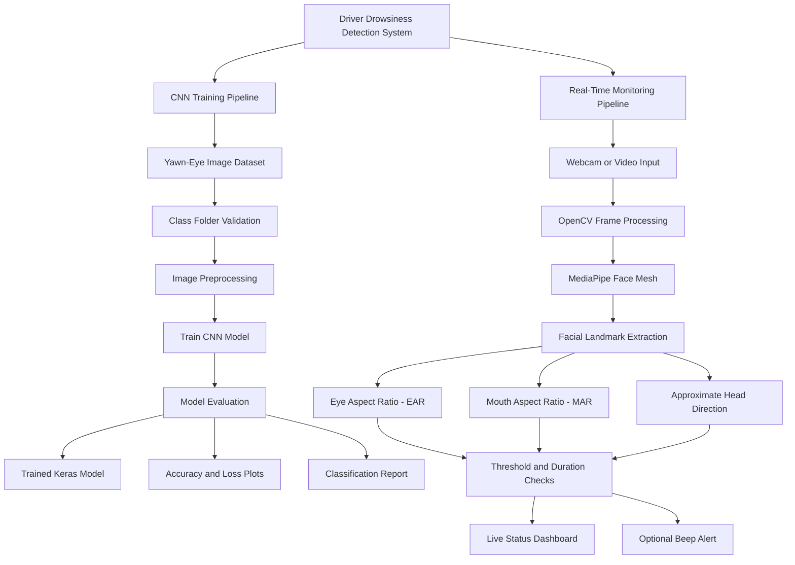
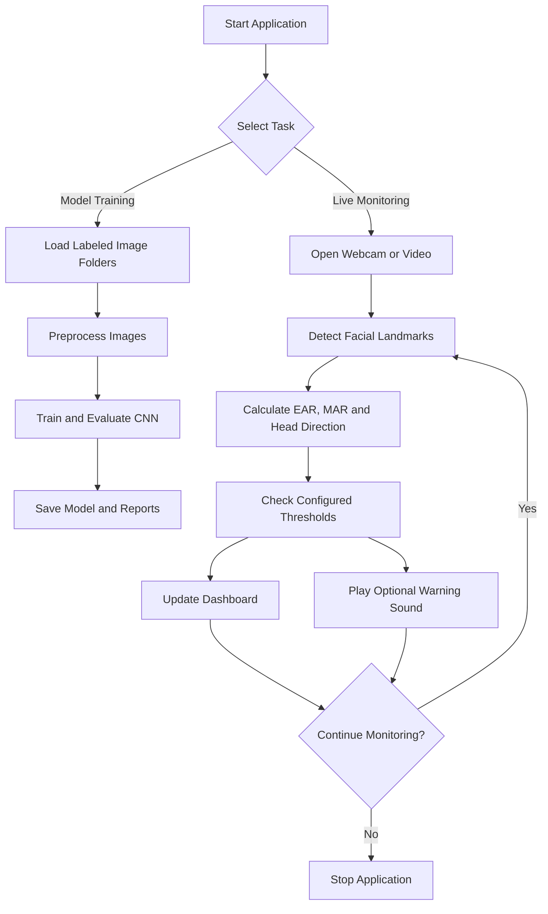

# Driver Drowsiness and Inattention Detection Using Deep Learning

A real-time driver monitoring system developed as a student mini-project to identify potential signs of driver drowsiness and inattention using computer vision, facial landmark analysis, and Convolutional Neural Networks (CNNs).

The project combines offline image-based model training with live webcam monitoring. It estimates eye closure, yawning, and approximate head direction, then displays monitoring results through visual indicators and optional audio alerts.

## 1. Project Overview

Driver drowsiness and inattention can reduce a driver's awareness and reaction time. This project demonstrates how computer vision can be used to monitor visible facial indicators that may be associated with fatigue or distraction.

The system consists of two main components:

- **CNN Training Module:** Trains an image classification model using a folder-based Yawn-Eye dataset and evaluates its classification performance.
- **Real-Time Monitoring Module:** Uses OpenCV and MediaPipe Face Mesh to process webcam frames, estimate facial indicators, and display live warnings.

The CNN training module and webcam monitoring module operate separately. The live monitoring module does not automatically use the trained CNN model because the training images may contain cropped eyes or mouth regions rather than complete faces.

## 2. Project Objectives

- Detect possible eye closure using facial landmarks.
- Identify possible yawning using mouth measurements.
- Estimate approximate head direction to indicate potential inattention.
- Display live monitoring information through an on-screen interface.
- Provide optional beep alerts when configured warning conditions are met.
- Train and evaluate a CNN image classifier using labeled image folders.
- Visualize training accuracy and loss.
- Generate a classification report to examine model performance.

## 3. Key Features

### A. CNN-Based Image Classification

- Supports a folder-based Yawn-Eye image dataset.
- Trains a Convolutional Neural Network using labeled image classes.
- Saves the trained model in Keras format.
- Generates training accuracy and loss plots.
- Produces a classification report for evaluation.

### B. Real-Time Webcam Monitoring

- Captures live frames using OpenCV.
- Detects facial landmarks using MediaPipe Face Mesh.
- Estimates eye closure using the Eye Aspect Ratio (EAR).
- Estimates mouth opening and possible yawning using the Mouth Aspect Ratio (MAR).
- Estimates approximate head direction from facial landmarks.
- Displays status indicators and warning messages.
- Supports optional audio alerts.
- Allows webcam or video-file input, depending on the monitoring script's supported arguments.

### C. Performance Evaluation

- Training and validation accuracy.
- Training and validation loss.
- Classification report with precision, recall, and F1-score.
- Visual inspection of detection behavior during stationary testing.

## 4. Project Architecture

The system is organized into two independent processing pipelines: an offline CNN training pipeline and a real-time facial monitoring pipeline.



### Architecture Explanation

**1. Dataset Input**

The training pipeline receives labeled images arranged into separate class folders, such as `open_eyes`, `closed_eyes`, `yawn`, and `no_yawn`.

**2. Image Preprocessing**

The training script loads images, applies the preprocessing required by the CNN, and prepares them for model training.

**3. CNN Model Training**

A Convolutional Neural Network learns image patterns from the training data. The model is evaluated using the configured training and validation workflow.

**4. Model Evaluation**

The training module produces accuracy and loss plots and a classification report. These outputs help assess the classifier's performance on the evaluation data.

**5. Live Video Capture**

OpenCV captures frames from a webcam or a supported video file.

**6. Facial Landmark Detection**

MediaPipe Face Mesh estimates facial landmark positions from each frame. These landmarks are used to calculate eye and mouth measurements and estimate head direction.

**7. Indicator Analysis**

EAR, MAR, and approximate head-direction values are compared with configured thresholds. Persistence checks help avoid triggering certain warnings from a single frame.

**8. Warning and Visualization**

The monitoring interface displays the current detection status and can play a beep when configured warning conditions are satisfied.

**Important:** The trained CNN and the real-time landmark pipeline are separate in this implementation. The architecture does not claim that the CNN directly classifies webcam frames.

## 5. System Workflow



## 6. Technologies Used

| Technology | Purpose |
|---|---|
| Python | Main programming language |
| TensorFlow / Keras | CNN training and model saving |
| OpenCV | Webcam capture and image processing |
| MediaPipe Face Mesh | Facial landmark detection |
| NumPy | Numerical calculations |
| Matplotlib | Accuracy and loss visualization |
| Scikit-learn | Classification metrics, if used by the trainer |
| Tkinter | Monitoring dashboard, if used by the interface |
| Pillow | Image display in the interface, if required |

The exact packages required depend on the imports used by the included source files. Refer to `requirements.txt` for the project environment.

## 7. Dataset Information

### Yawn-Eye Image Dataset

The CNN training module expects an image dataset organized by class. The exact folder structure depends on the dataset version you downloaded.

Example structure:

```text
dataset/
└── yawn_eye/
    ├── open_eyes/
    ├── closed_eyes/
    ├── yawn/
    └── no_yawn/
```

Each class folder should contain images belonging to that class.

If your downloaded dataset uses different class names, rename or copy the folders as needed to match the trainer's expected labels.

**Dataset preparation guidelines:**

- Keep each class in its own folder.
- Avoid mixing unrelated image or crop types within a class.
- Check that image files are readable.
- Inspect the class distribution before training.
- Use a suitable training, validation, and test strategy to evaluate generalization.

### Dataset Distinction

NTHU-DDD is a video-based driver drowsiness dataset, whereas Yawn-Eye is an image-based dataset. They are not interchangeable without suitable preprocessing.

This project uses the folder-based Yawn-Eye images for CNN training. The real-time monitoring module uses facial landmarks instead of assuming the training images are full-face webcam images.

## 8. Installation and Setup

### Prerequisites

- Windows 10 or Windows 11.
- Python 3.10 or 3.11, subject to package compatibility.
- A working webcam for live monitoring.
- Git, if cloning the repository.
- Required Python packages.

### Step 1: Clone the Repository

```bash
git clone https://github.com/chitherpandik/Driver-Drowsiness-Detection.git
cd Driver-Drowsiness-Detection
```

### Step 2: Create a Virtual Environment

For Python 3.10:

```bash
py -3.10 -m venv .venv
```

Alternatively, use Python 3.11 if that is the installed version supported by your dependencies.

### Step 3: Activate the Environment

```bash
.venv\Scripts\activate
```

### Step 4: Upgrade pip

```bash
python -m pip install --upgrade pip
```

### Step 5: Install Dependencies

```bash
pip install -r requirements.txt
```

If installation fails, verify the Python version and the compatibility of TensorFlow, MediaPipe, NumPy, and OpenCV. Install compatible package versions in the virtual environment.

## 9. Train the CNN Model

Place the image classes under:

```text
dataset/yawn_eye/
```

Run the training script:

```bash
python train_model.py --data dataset/yawn_eye --epochs 15
```

This command assumes `train_model.py` supports the `--data` and `--epochs` arguments.

The training module is expected to save its outputs in locations such as:

```text
models/
└── yawn_eye_cnn.keras

outputs/
├── accuracy.png
├── loss.png
└── classification_report.txt
```

The actual filenames depend on the implementation of the training script.

### Training Outputs

- **Trained model:** The saved CNN for the configured image classes.
- **Accuracy plot:** Shows training and validation accuracy over epochs.
- **Loss plot:** Shows training and validation loss over epochs.
- **Classification report:** Summarizes class-wise precision, recall, and F1-score when supported by the trainer.

Training accuracy alone does not establish reliable real-world detection. Evaluate the model using data that was not used to train it, and check for class imbalance and data leakage.

## 10. Run Real-Time Monitoring

Start the webcam monitoring module:

```bash
python webcam_monitor.py
```

If the script supports camera selection and your webcam is not camera `0`, try:

```bash
python webcam_monitor.py --camera 1
```

To process a video file, if supported by the script:

```bash
python webcam_monitor.py --video path/to/video.mp4
```

Press **Q** to quit if that keyboard shortcut is implemented by the active monitoring interface.

### Real-Time Processing Steps

1. Capture a video frame.
2. Process the frame using OpenCV.
3. Detect facial landmarks with MediaPipe Face Mesh.
4. Calculate EAR and MAR.
5. Estimate approximate head direction.
6. Compare measurements against configured thresholds.
7. Update the visual status indicators.
8. Play an optional beep when a warning condition is met.

## 11. Detection Methods

### Eye Aspect Ratio (EAR)

EAR measures the relative vertical opening of the eye compared with its horizontal width.

\[
EAR=\frac{d_1+d_2}{2d_h}
\]

Here, \(d_1\) and \(d_2\) represent vertical eye-landmark distances, while \(d_h\) represents the horizontal distance between eye corners.

A lower EAR may indicate eye closure. A sustained low value can be used to trigger a possible eye-closure warning.

### Mouth Aspect Ratio (MAR)

MAR measures the relative vertical opening of the mouth compared with its horizontal width.

\[
MAR=\frac{d_v}{d_h}
\]

Here, \(d_v\) represents a vertical mouth-landmark distance and \(d_h\) represents a horizontal mouth-landmark distance. Some implementations average multiple vertical distances.

A high MAR that persists over multiple frames may indicate possible yawning. Speaking, facial expressions, and camera angle can also affect this measurement.

### Approximate Head Direction

Facial landmark positions are used to estimate whether the face appears to turn away from a roughly forward-facing direction.

This is an approximate indicator rather than calibrated 3D head-pose estimation or true gaze tracking. Looking sideways with the eyes alone may not be detected reliably.

### Warning Conditions

Warning conditions are based on configured thresholds and, where implemented, the duration for which an indicator persists.

Thresholds should be adjusted and tested under different lighting conditions, camera positions, and individual facial characteristics. Short-lived changes can produce false positives.

## 12. Suggested Project Structure

```text
Driver-Drowsiness-Detection/
│
├── dataset/
│   └── yawn_eye/
│       ├── open_eyes/
│       ├── closed_eyes/
│       ├── yawn/
│       └── no_yawn/
│
├── models/
│   └── yawn_eye_cnn.keras
│
├── outputs/
│   ├── accuracy.png
│   ├── loss.png
│   └── classification_report.txt
│
├── train_model.py
├── webcam_monitor.py
├── requirements.txt
├── .gitignore
└── README.md
```

Dataset images, generated outputs, and model files may be excluded from Git if they are large or unsuitable for public distribution. The folder layout above is illustrative; include only files that actually exist in your repository.

## 13. Troubleshooting

| Problem | Suggested solution |
|---|---|
| Webcam does not open | Check camera permissions and try another camera index if supported. |
| MediaPipe import error | Verify the installed MediaPipe version and its compatibility with the project code. |
| TensorFlow installation fails | Check the Python version and supported package versions. |
| Dataset folder not found | Verify the dataset path and class-folder structure. |
| Model file not found | Run the training script first if the model is required for a task. |
| Incorrect detection | Review landmark positions, thresholds, lighting, and camera placement. |
| Frequent false alerts | Adjust persistence thresholds and evaluate under stationary conditions. |

## 14. Limitations and Safety

- Performance depends on lighting, face visibility, camera placement, and individual differences.
- Glasses, occlusions, head movement, and poor image quality may affect landmark detection.
- EAR and MAR thresholds are heuristic indicators, not medical or definitive fatigue measurements.
- Approximate head direction is not equivalent to eye-gaze tracking.
- A warning sound does not guarantee that drowsiness or distraction will be detected.
- The CNN's performance depends on the dataset, class balance, preprocessing, and evaluation methodology.
- The independently trained CNN is not automatically integrated into the live webcam pipeline.

**Safety notice:** This is an educational prototype, not a certified driver-safety system. Test the application while stationary. Never operate the code, adjust thresholds, or interact with the computer while driving.

## 15. Future Enhancements

- Integrate a validated eye or mouth classifier into the real-time pipeline.
- Improve head-pose estimation using calibrated pose estimation.
- Add configurable alert thresholds and warning duration.
- Record timestamped events for later review, with appropriate privacy controls.
- Improve model evaluation using subject-independent test data.
- Develop a more accessible dashboard with configurable visual indicators.
- Evaluate the system under varied lighting, camera positions, and realistic stationary test conditions.

## 16. Author and Project Information

**Project:** Driver Drowsiness and Inattention Detection  
**Project Type:** Student Mini-Project  
**Language:** Python  
**Primary Focus:** Deep Learning and Computer Vision  
**Repository:** https://github.com/chitherpandik/Driver-Drowsiness-Detection

Add your name, institution, and academic details here if you want to include them in the public repository.

## 17. License

No license is specified by default. If you plan to allow others to reuse or modify the project, choose an appropriate open-source license and verify that your dataset and dependencies permit the intended use.
